<picture>
  <source media="(prefers-color-scheme: dark)" srcset="assets/hero-dark.svg">
  
</picture>

 
 

<h2>
  <picture>
    <source media="(prefers-color-scheme: dark)" srcset="assets/label-built-dark.svg">
    
  </picture>
</h2>

* **[Gruber 🕊️](https://gruber.garvitsingla.in)**: Realtime Markdown-to-slides presentation engine. Built a custom lexer, tokenizer, and AST parser completely from scratch with zero dependencies in native JavaScript. · [launch live](https://gruber.garvitsingla.in) · [github](https://github.com/garvittsingla/gruber)
* **[TypeRush 🪐](https://typerush.garvitsingla.in)**: Real-time multiplayer typing duel engine built with a custom WebSocket architecture. Features room-based matchmaking, synchronized race countdowns, live opponent cursor/progress tracking, and instant WPM analytics. · [launch live](https://typerush.garvitsingla.in) · [github](https://github.com/garvittsingla/typerush)
* **[nslookup in C](https://github.com/garvittsingla/nslookup)**: Command-line DNS resolver written from scratch in C using the UNIX Sockets API. Crafts 512-byte RFC 1035 wire datagrams, connects to UDP port 53, parses 12-byte header bitfields, and unpacks recursive A/AAAA records. · [github](https://github.com/garvittsingla/nslookup)
* **[http-server-cpp](https://github.com/garvittsingla/http-server-cpp)**: Lightweight multithreaded HTTP/1.1 server implementation from scratch in modern C++, supporting concurrent POSIX socket connections, request headers parsing, and static file streaming. · [github](https://github.com/garvittsingla/http-server-cpp)

<h2>
  <picture>
    <source media="(prefers-color-scheme: dark)" srcset="assets/label-writings-dark.svg">
    
  </picture>
</h2>

* [implementing nslookup](https://garvitsingla.in/blog/nslookup)
* [Building a Custom HTTP Server from Scratch in C++](https://garvitsingla.in/blog/http-server-in-cpp)
* [You suck at Subnetting](https://garvitsingla.in/blog/you-suck-at-subnetting)

<h2>
  <picture>
    <source media="(prefers-color-scheme: dark)" srcset="assets/label-socials-dark.svg">
    
  </picture>
</h2>

[portfolio](https://garvitsingla.in) &nbsp;·&nbsp; [github](https://github.com/garvittsingla) &nbsp;·&nbsp; [linkedin](https://linkedin.com/in/garvittsingla) &nbsp;·&nbsp; [x / twitter](https://twitter.com/garvitsinglaa) &nbsp;·&nbsp; [email](mailto:garvitsingla4751@gmail.com)

 

<picture>
  <source media="(prefers-color-scheme: dark)" srcset="assets/wire-dark.svg">
  
</picture>
