<picture>
  <source media="(prefers-color-scheme: dark)" srcset="assets/hero-v3-dark.svg">
  
</picture>

 
 

<h2>
  <picture>
    <source media="(prefers-color-scheme: dark)" srcset="assets/label-built-dark.svg">
    
  </picture>
</h2>

<ul>
  <li>
    <strong><a href="https://github.com/garvittsingla/nslookup">nslookup in C</a></strong>:
    Command-line DNS resolver written from scratch in C using the UNIX Sockets API.
    · <a href="https://github.com/garvittsingla/nslookup">github</a>
  </li>
  <li>
    <strong><a href="https://github.com/garvittsingla/ccp">ccp (Captive Portal CLI)</a></strong>:
    Automatic portal detection and login on basis of saved credentials.
    · <a href="https://github.com/garvittsingla/ccp">github</a>
  </li>
  <li>
    <strong><a href="https://gruber.garvitsingla.in">Gruber 🕊️</a></strong>:
    Realtime Markdown-to-slides presentation engine. Built a custom lexer, tokenizer, and AST parser.
    · <a href="https://gruber.garvitsingla.in">launch live</a>
    · <a href="https://github.com/garvittsingla/gruber">github</a>
  </li>
  <li>
    <strong><a href="https://typerush.garvitsingla.in">TypeRush 🪐</a></strong>:
    Real-time multiplayer typing game with a WebSocket architecture.
    · <a href="https://typerush.garvitsingla.in">launch live</a>
    · <a href="https://github.com/garvittsingla/typerush">github</a>
  </li>
  <li>
    <strong><a href="https://github.com/garvittsingla/http-server-cpp">http-server-cpp</a></strong>:
    Lightweight HTTP/1.1 server implementation from scratch in modern C++.
    · <a href="https://github.com/garvittsingla/http-server-cpp">github</a>
  </li>
</ul>

<h2>
  <picture>
    <source media="(prefers-color-scheme: dark)" srcset="assets/label-writings-dark.svg">
    
  </picture>
</h2>

<ul>
  <li>
    <a href="https://garvitsingla.in/blog/nslookup">implementing nslookup</a>
  </li>
</ul>

<h2>
  <picture>
    <source media="(prefers-color-scheme: dark)" srcset="assets/label-socials-dark.svg">
    
  </picture>
</h2>

  <a href="https://garvitsingla.in">web</a>
  &nbsp;·&nbsp;
  <a href="https://linkedin.com/in/garvittsingla">linkedin</a>
  &nbsp;·&nbsp;
  <a href="https://twitter.com/garvitsinglaa">x</a>
  &nbsp;·&nbsp;
  <a href="mailto:garvitsingla4751@gmail.com">email</a>

 

<picture>
  <source media="(prefers-color-scheme: dark)" srcset="assets/wire-amber-dark.svg">
  
</picture>
