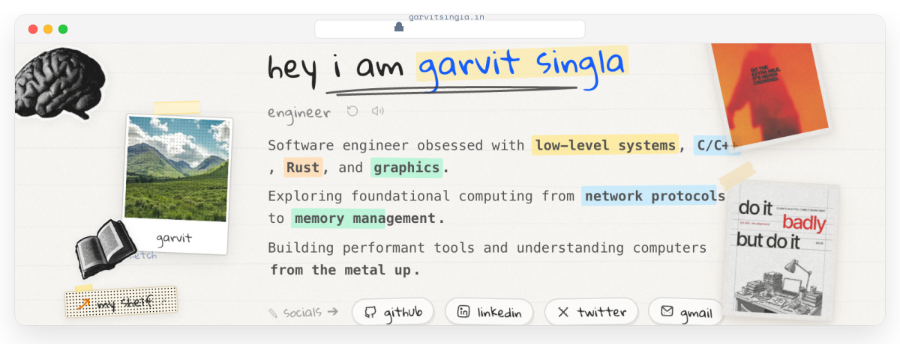
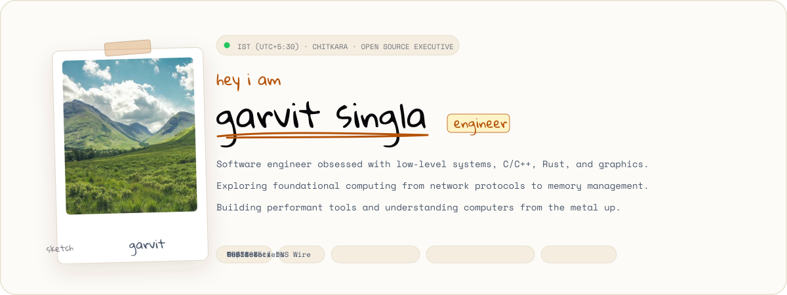
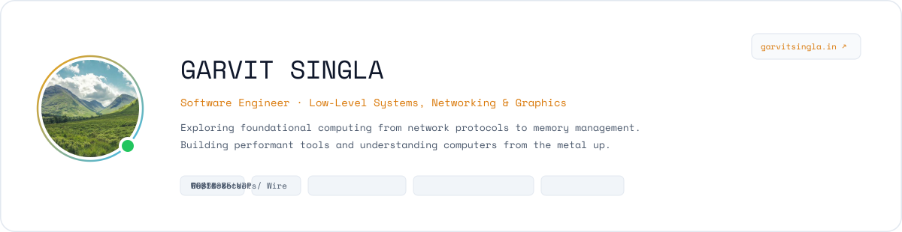

> [!TIP]
> **Click any tab below to toggle between the 3 hero designs:**

  
<b>Option 1: macOS / Arc Browser Frame (Active)</b>

   

<a href="https://garvitsingla.in" target="_blank" rel="noopener noreferrer">
  <picture>
    <source media="(prefers-color-scheme: dark)" srcset="assets/opt1-browser-dark.svg">
    
  </picture>
</a>

  
<b>Option 2: Studio Desk / Sketchbook Canvas</b>

   

<a href="https://garvitsingla.in" target="_blank" rel="noopener noreferrer">
  <picture>
    <source media="(prefers-color-scheme: dark)" srcset="assets/opt2-sketchbook-dark.svg">
    
  </picture>
</a>

  
<b>Option 3: Minimalist Developer Card</b>

   

<a href="https://garvitsingla.in" target="_blank" rel="noopener noreferrer">
  <picture>
    <source media="(prefers-color-scheme: dark)" srcset="assets/opt3-minimal-dark.svg">
    
  </picture>
</a>

### things i recently did

- **[Gruber 🕊️](https://github.com/garvittsingla/gruber)**: Realtime Markdown to Slides Presentation Engine with a custom lexer, tokenizer, and parser written completely from scratch in native JavaScript. · [live](https://gruber.garvitsingla.in) · [github](https://github.com/garvittsingla/gruber)
- **[TypeRush 🪐](https://github.com/garvittsingla/typerush)**: Real-time multiplayer typing duel engine built with custom WebSockets, live opponent progress/cursor tracking, and synchronized countdowns. · [live](https://typerush.garvitsingla.in) · [github](https://github.com/garvittsingla/typerush)
- **[nslookup in C](https://github.com/garvittsingla/nslookup)**: Custom DNS Resolver using UNIX Sockets API. Crafts 512-byte RFC 1035 wire datagrams, connects to UDP port 53, and unpacks recursive A/AAAA records. · [github](https://github.com/garvittsingla/nslookup)
- **[http-server-cpp](https://github.com/garvittsingla/http-server-cpp)**: Lightweight multithreaded HTTP/1.1 server from scratch in modern C++ supporting concurrent connections, header parsing, and static file serving. · [github](https://github.com/garvittsingla/http-server-cpp)

### recent writings

- [implementing nslookup](https://garvitsingla.in/blog/nslookup)
- [Building a Custom HTTP Server from Scratch in C++](https://garvitsingla.in/blog/http-server-in-cpp)
- [You suck at Subnetting](https://garvitsingla.in/blog/you-suck-at-subnetting)

### elsewhere

[portfolio](https://garvitsingla.in) &nbsp;·&nbsp; [github](https://github.com/garvittsingla) &nbsp;·&nbsp; [linkedin](https://linkedin.com/in/garvittsingla) &nbsp;·&nbsp; [x / twitter](https://twitter.com/garvitsinglaa) &nbsp;·&nbsp; [email](mailto:garvitsingla4751@gmail.com)
